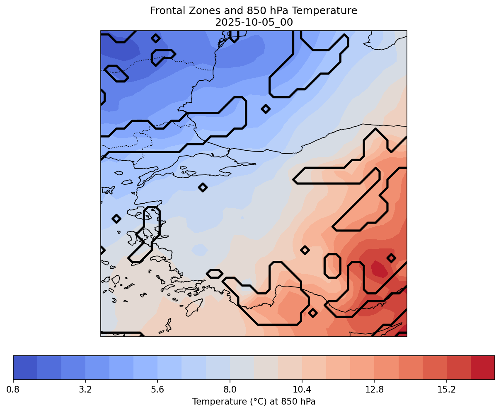
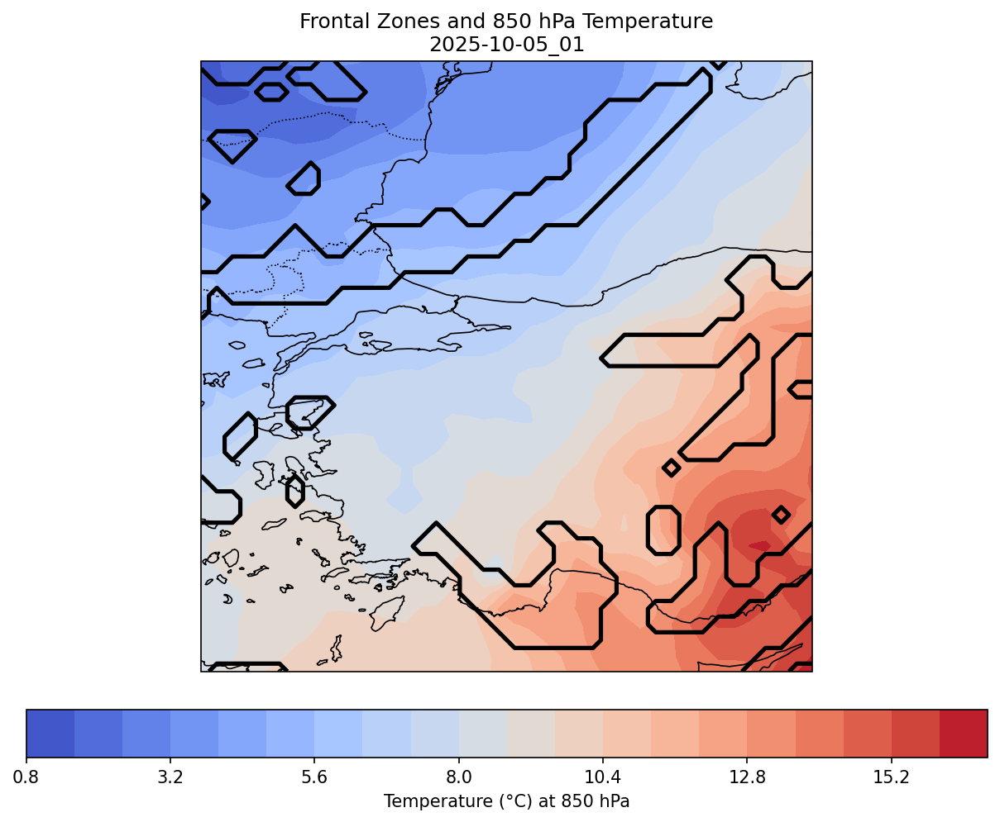
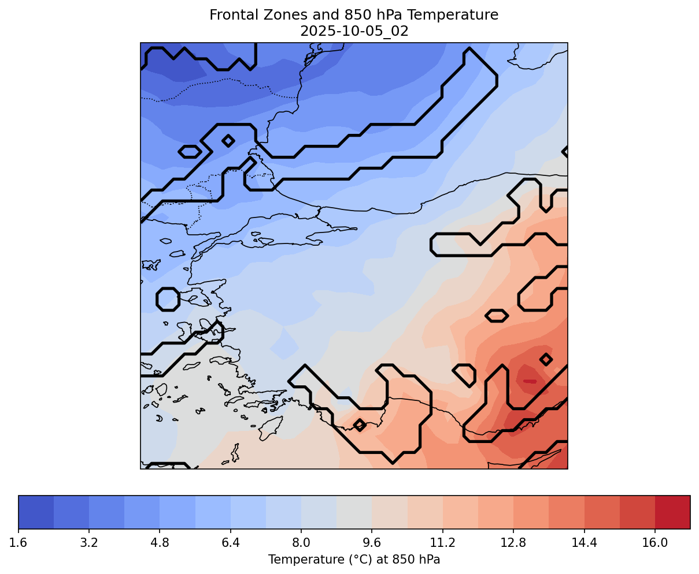
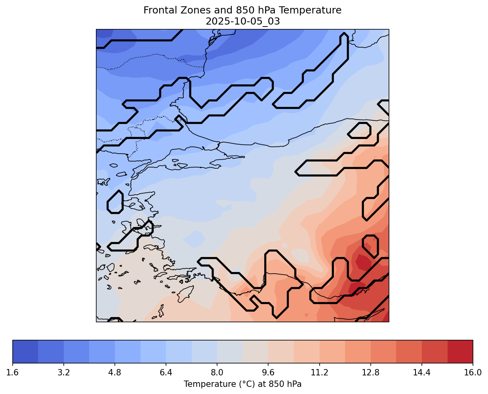
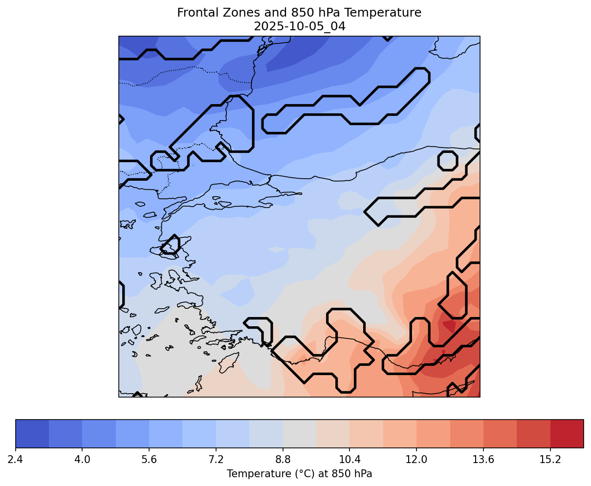

# MTO-Front-Identifier

Objective meteorological front identification, thermal-advection front classification, and geospatial visualization on ERA5 pressure-level data (default: `850 hPa`).

## Implemented Methods

All identification functions return a binary `xarray.DataArray` (`front_mask`: `1` = frontal zone, `0` = non-frontal) with dimensions `("time", "latitude", "longitude")`.

| Method Key | Function | Required Variables | Default Threshold | Description |
| :--- | :--- | :--- | :--- | :--- |
| `theta_e` | `identify_fronts` | `t`, `q` | `4e-5 K/m` | Equivalent potential temperature gradient magnitude $|\nabla \theta_e|$ |
| `f_diagnostic` | `identify_fronts_f_diagnostic` | `t`, `u`, `v` | `1.0` (dimensionless) | Hewson/Parfitt F-diagnostic: $(\zeta_p / f) \cdot (|\nabla T_p| / |\nabla T|_0)$ with $|\nabla T|_0 = 0.45\text{ K}/100\text{ km}$ |
| `tfp` | `identify_fronts_tfp` | `t` (optional `q`) | `grad: 2e-5 K/m`, `tfp: 0.0 K/m²` | Renard & Clarke (1965) Thermal Front Parameter: $-\nabla |\nabla \tau| \cdot (\nabla \tau / |\nabla \tau|)$ ($\tau = \theta_e$ if `q` is provided, else $\theta$) |
| `frontogenesis` | `identify_fronts_frontogenesis` | `t`, `u`, `v` | `0.5 K/(100 km · 3 h)` | Petterssen (1936) 2D horizontal kinematic frontogenesis of $\theta$ |

### Frontal Type Classification

`classify_front_type` classifies any binary `front_mask` into synoptic front types using horizontal temperature advection ($-\mathbf{V} \cdot \nabla T$) at the target pressure level (`advection_threshold = 1e-5 K/s` by default):

- `0`: Non-frontal region
- `1`: **Cold front** (cold-air advection $< -10^{-5}\text{ K/s}$)
- `2`: **Warm front** (warm-air advection $> +10^{-5}\text{ K/s}$)
- `3`: **Stationary / neutral front**

---

## Installation

This project uses `uv` with Python `>=3.11` (pinned in `.python-version` to `3.11`).

```bash
uv sync
```

To include development/test dependencies (`pytest`):

```bash
uv sync --all-groups
```

> **Note:** Reading raw `.grib` files via `cfgrib` requires the system `ecCodes` C library.

---

## Usage

### 1. CLI Pipeline (`app.py`)

Preprocess raw ERA5 GRIB files (`era5_<var>_*.grib`), run front identification, and generate plots:

```bash
# Default run (F-diagnostic at 850 hPa using existing preprocessed NetCDFs in ./outputs)
uv run python app.py

# Preprocess raw GRIB files first, then run F-diagnostic with custom threshold
uv run python app.py --preprocess --input-dir ./raw_data --output-dir ./outputs --method f_diagnostic --threshold 1.5

# Run Equivalent Potential Temperature gradient method
uv run python app.py --method theta_e --threshold 4e-5

# Run Thermal Front Parameter (TFP) or 2D Frontogenesis with cold/warm classification
uv run python app.py --method frontogenesis --classify

# Run all four methods and generate a side-by-side comparison plot
uv run python app.py --method all --classify --compare --force
```

Run `uv run python app.py --help` to inspect all flags (`--pressure-level`, `--lat-range`, `--lon-range`, `--time-range`, `--no-time-range`, `--max-plots`, `--log-level`).

### 2. Python API

```python
import xarray as xr
from src import (
    classify_front_type,
    identify_fronts,
    identify_fronts_f_diagnostic,
    identify_fronts_frontogenesis,
    identify_fronts_tfp,
)

ds_t = xr.open_dataset("outputs/era5_t.nc")
ds_q = xr.open_dataset("outputs/era5_q.nc")
ds_u = xr.open_dataset("outputs/era5_u.nc")
ds_v = xr.open_dataset("outputs/era5_v.nc")

# Preserved methods
mask_theta_e = identify_fronts(ds_t, ds_q)
mask_f_diag = identify_fronts_f_diagnostic(ds_t, ds_u, ds_v, threshold=1.0)

# Newly added methods
mask_tfp = identify_fronts_tfp(ds_t, ds_q=ds_q)
mask_fronto = identify_fronts_frontogenesis(ds_t, ds_u, ds_v, threshold=0.5)

# Cold / warm / stationary front classification
front_types = classify_front_type(mask_f_diag, ds_t, ds_u, ds_v)
```

---

## Project Structure

```text
MTO-Front-Identifier/
├── app.py               # CLI pipeline runner (preprocessing, identification, classification, plotting)
├── pyproject.toml       # Project metadata, dependencies, and pytest configuration
├── outputs/
│   └── plots/           # Sample generated 850 hPa frontal zone maps
├── src/
│   ├── __init__.py      # Public package exports
│   ├── identifier.py    # Front identification methods & advection-based classification
│   ├── plot.py          # Cartopy map plotting (single mask, classified fronts, method comparison)
│   └── utils.py         # ERA5 GRIB preprocessing and NetCDF dataset loading helpers
└── tests/
    ├── test_identifier.py
    └── test_utils.py
```

---

## Sample Outputs

The maps below show sample 850 hPa ERA5 outputs generated over `35.25°N–45.0°N, 25.0°E–34.75°E` (Western Black Sea, Marmara, Aegean, and Anatolia) for consecutive hourly timesteps on **2025-10-05 (`00:00`–`04:00 UTC`)**. Filled contours show 850 hPa temperature (°C), and solid black contours outline the identified frontal zones (`front_mask = 1`):

| 2025-10-05 00:00 UTC | 2025-10-05 01:00 UTC | 2025-10-05 02:00 UTC |
| :---: | :---: | :---: |
|  |  |  |

| 2025-10-05 03:00 UTC | 2025-10-05 04:00 UTC |
| :---: | :---: |
|  |  |

### Output Artifacts Produced by the Pipeline

- `outputs/era5_<var>.nc`: Geographically subsetted and time-sorted NetCDF files for each preprocessed variable (`q`, `t`, `u`, `v`).
- `outputs/front_mask_<method>_850hPa.nc` (or `outputs/front_mask_850hPa.nc` for default `f_diagnostic`): Binary `front_mask` DataArray with method and threshold metadata.
- `outputs/front_type_<method>_850hPa.nc` (when `--classify` is enabled): Integer `front_type` DataArray (`0` = no front, `1` = cold front, `2` = warm front, `3` = stationary front).
- `outputs/plots/front_map_<YYYY-MM-DD_HH>.png`: 850 hPa temperature background with black frontal zone contours.
- `outputs/plots/front_classified_<YYYY-MM-DD_HH>.png`: Color-coded cold (blue), warm (red), and stationary (purple) front contours when `--classify` is enabled.
- `outputs/plots/front_comparison_<YYYY-MM-DD_HH>.png`: Multi-panel method comparison when running `--method all --compare`.

---

## Running Tests

```bash
uv run pytest -v
```
